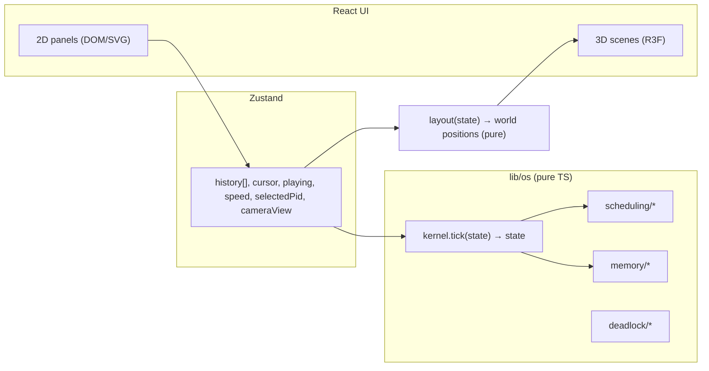

# OS Visualizer 3D: Implementation Plan (revised for three.js)

**Goal:** A Next.js web app that simulates a small computer in 3D. You can watch a process go from creation through memory allocation, scheduling, execution, I/O and termination on an isometric "motherboard". Separate Labs let you explore each OS algorithm on its own.

**Stack:** Next.js 16 (App Router) · React 19 · TypeScript · **three.js + React Three Fiber 9 + drei 10** · maath (easing) · Zustand · immer · CSS Modules · Vitest 3
**Node:** 20.9+ (Vitest is pinned to 3.x and Vite to 6.x because Node 20.18 is in use)

> [!NOTE]
> **Status:** all P0 and P1 modules are built and tested. P0 is the landing page, Virtual Computer, Scheduling, Page Replacement and Banker's. P1 is Memory Partitioning, Producer–Consumer and Deadlock Detection. P2 extensions are listed in section 8.

---

## 1. What changed from the 2D plan

| Area | 2D plan | 3D build |
|---|---|---|
| Main visuals | SVG + Framer Motion `layoutId` | three.js scenes (isometric, orthographic camera, low-poly pastel) |
| Motion | `layoutId` tweening | **Target-position damping**: a pure `layout(state)` returns world positions, and each mesh eases toward its target every frame. Step forward/back animates for free. |
| Text-heavy UI | SVG/DOM | **Unchanged.** Controls, tables, Gantt, metrics, event log and PCB drawer stay as crisp 2D DOM/SVG ("hybrid 3D") |
| Framer Motion | dependency | dropped (DOM uses CSS transitions) |
| Fonts | — | Inter, self-hosted (`@fontsource/inter` for DOM, `public/fonts/*.woff` for 3D text), so it works offline |

**Engine fixes made during review** (these make the kernel testable and the 3D views possible):
1. **Seeded RNG** (`lib/os/rng.ts`). The RNG state lives in `SimState`, so `tick()` is pure and replays are exact. Never call `Math.random` in `lib/os`.
2. **Pre-generated reference strings.** Each PCB gets `refs[]` (locality model) when it is created, so **OPT works inside the kernel** too.
3. **`ctxSwitch` / `lastSwitch` state.** Context switches take `ctxSwitchCost` ticks and are drawn as PCB slabs flying between the CPU and the PCB table.
4. **Page faults use the DISK queue** (`waitReason: 'PAGE_FAULT'`, `pageFaultCost` ticks). The logic and the picture match.
5. **`SimConfig` is defined:** `algo, quantum, numFrames, replacement, ctxSwitchCost, pageFaultCost, seed`.
6. **immer** gives structural sharing, and history is capped at 1000 snapshots.
7. **Documented tie-breaks.** Ties go to the earliest arrival, then the lowest PID. In RR, new arrivals queue ahead of the preempted process.
8. **Time accounting:** `stats.busy + stats.idle + stats.ctx == clock` is a tested invariant.

---

## 2. Architecture



**Rule:** all OS logic stays in `lib/os` with no React. 3D scenes only render what `layout*()` returns.

### Kernel tick order (`lib/os/kernel.ts`)
arrivals → long-term scheduler (admit if a free frame exists) → short-term scheduler (+ context switch) → waiting accounting → device tick → CPU tick (memory reference, page fault, burst end) → I/O interrupts → preemption check → `clock++`.

---

## 3. Shared 3D kit (`components/three/`)

- **`IsoStage`**: client-only `<Canvas>` with an orthographic isometric camera, constrained `CameraControls`, soft lights, `ContactShadows`, auto-fit zoom to a world box (`view`), smooth camera presets (`viewKey`), and a WebGL fallback.
- **`primitives.tsx`**:
  - shapes: `Block` (rounded, flat-shaded), `Label` (flat or billboard text), `Pawn` (process token), `Pad`, `BlobShadow`
  - effects: `Flyer` (a one-shot flying slab)
  - hooks: `useDampedPosition`, `useDampedValue`
  - `MotionSpeed` context
- **`lib/palette.ts`**: the single source of colours for both CSS variables and three.js materials.

Always load scenes with `next/dynamic(..., { ssr: false })` from a client component.

---

## 4. Pages

| Route | 3D scene | 2D panels |
|---|---|---|
| `/` | Auto-rotating mini board (`HeroScene`) | Hero, module cards |
| `/computer` | Board with NEW pad, READY lane, CPU chip, RAM frames, DISK/PRINTER stations, PCB table, exit tray. Camera presets: Overview, CPU, Memory | Control bar, state diagram, queues, live Gantt, metrics, event log, PCB drawer. Deep link: `?preset=io|cpu|memory&play=1` |
| `/labs/scheduling` | Process lanes over time, with blocks that grow as the cursor sweeps; the front lane is the CPU | Process table, Gantt, CT/TAT/WT/RT table, "Compare all" bars |
| `/labs/page-replacement` | Column per reference, row per frame; faults drop in, hits glow. Modes: Explore, Compare all, Belady | Textbook table, faults-vs-frames chart |
| `/labs/bankers` | Work pool in the centre, ring of process pads (solid = Allocation, ghost = Need); released resources fly back | Editable matrices, Need, Work/Finish trace, request form |
| `/labs/memory` | RAM stick: blocks rise into holes, internal fragmentation is translucent, Compact slides blocks to address 0, waiting jobs float behind | Fixed/dynamic toggle, First/Best/Worst fit, textbook jobs, compare-strategies table, memory map |
| `/labs/sync` | Ring buffer with `in`/`out` pointers, producer and consumer pawns, semaphore gauges with queued-thread dots, mutex ring (amber while held), `count` vs real items | Per-thread code with a pc marker and a Step button, semaphore values, trace. Semaphores-off mode shows lost updates, overwrites and garbage reads |
| `/labs/deadlock` | Bipartite RAG: process spheres and resource boxes with instance dots. Request and assignment arcs; cycle edges coral; released edges fade during detection | Scenario presets (Fig 7.2/7.3/7.4, 5-process detection), detection trace, Coffman conditions, abort/preempt recovery with undo, editable matrices |

---

## 5. Folder structure

```
app/                       layout, landing, computer/, labs/{scheduling,page-replacement,bankers}/
components/three/          IsoStage, primitives (shared 3D kit)
components/computer3d/     ComputerScene, parts (CPU, RAM, devices, tokens), layout.ts (pure)
components/computer/       Dashboard, ControlBar, StateDiagram, InfoPanels, PcbDrawer
components/labs/<lab>/     <Lab>.tsx (2D + state) and <X>Scene.tsx (3D)
components/charts/         GanttChart, BarChart, LineChart (hand-made SVG)
components/ui/             NavBar, Button, Panel, Field, Select, NumberInput, Stat, Banner
lib/os/                    types, rng, kernel, workload, scheduling/, memory/ (paging, replacement, partitioning), deadlock/ (bankers, detection), sync/
store/simStore.ts          Zustand store (history + playback state)
tests/                     Vitest: textbook answers + kernel invariants + layout
```

---

## 6. Verification

`npm test` runs 73 tests:
- **Belady:** FIFO gives 9 faults with 3 frames and 10 with 4.
- **Textbook string @ 3 frames:** FIFO 15, LRU 12, OPT 9.
- **Banker's:** Silberschatz sequence ⟨P1, P3, P4, P0, P2⟩. Request P1 (1,0,2) is granted, P4 (3,3,0) must wait, P0 (0,2,0) is denied.
- **Scheduling:** hand-solved FCFS, SJF, SRTF, RR (q = 2), Priority and Priority-preemptive.
- **Kernel invariants**, over 3 presets × 6 algorithms plus 3 replacement policies:
  - at most one RUNNING process
  - frames and page tables agree
  - every process is in exactly one queue
  - time is conserved
  - everything terminates
  - same seed → identical history
  - snapshots are immutable
- **Layout:** no two tokens share a position.
- **Partitioning** (Silberschatz 212/417/112/426 on holes 100/500/200/300/600):
  - Fixed: First fit → 500, 600, 200, then 426 waits. Best fit places all four, with 433K internal fragmentation. Worst fit → 600, 500, 300, then 426 waits.
  - Dynamic: the same, except that 112 goes into the 288K or 388K leftover.
  - Compaction admits the blocked 426K job, and free coalesces neighbouring holes.
- **Producer–Consumer:**
  - With semaphores, over 600 random steps on 5 seeds: mutual exclusion, `mutex` accounting, a bounded buffer and a consistent counter all hold.
  - Blocking and wake-up on a full or empty buffer.
  - Without semaphores: a lost `count` update, garbage reads and overwritten items.
- **Deadlock detection:**
  - Fig 7.2 has no cycle. Fig 7.3 deadlocks P1–P3. Fig 7.4 has a cycle without deadlock.
  - The 5-process example is safe, and P1–P4 deadlock after P2 requests one more C.
  - Aborting a process or preempting a resource breaks the deadlock.

`npm run build` must pass before deploying.

---

## 7. Demo script (about 5 minutes)

1. Landing → **Virtual Computer**. Pick the **I/O-bound mix** and press ▶. Narrate tokens hopping NEW → READY → CPU → DISK/PRINTER → READY → TERMINATED.
2. Pause and click a token to show its **PCB** (registers, bursts, page table). Press Step until the **context-switch** banner appears and the PCB slabs fly.
3. Switch the scheduler RR → FCFS mid-run and compare the metrics.
4. Load **Memory pressure**: watch page cubes fly from DISK into RAM, the "I/O · fault" edge lighting up, and P6 held in NEW (admission control).
5. Labs: Scheduling "Compare all" → Page Replacement **Belady's anomaly** → Banker's: grant P1, then show P0 denied.

---

## 8. Next: P2 extensions (same pattern)

For each new lab:
1. Add a pure engine in `lib/os/...` plus textbook tests.
2. Add a `components/labs/<lab>/<X>Scene.tsx` built from `IsoStage` + `Block`/`Label`/`Flyer`.
3. Add a `<Lab>.tsx` that holds state and 2D panels and loads the scene with `next/dynamic({ ssr: false })`.
4. Add a route in `app/labs/<lab>/page.tsx`, a NavBar link and a landing card.

| Extension | 3D idea |
|---|---|
| Readers–Writers | Reuse the sync engine's statement-level interleaving. Readers share a database block, and a writer locks it (amber ring). |
| Thrashing chart | Run the kernel's Memory-pressure preset at increasing degrees of multiprogramming and plot CPU utilisation (2D line chart). |
| Disk scheduling | A platter with a moving head arm. Draw the head path for FCFS, SSTF, SCAN and C-SCAN, with total head movement. |
| Simulated shell | A terminal panel whose `ps`, `kill <pid>` and `nice` commands drive the Virtual Computer store. |
